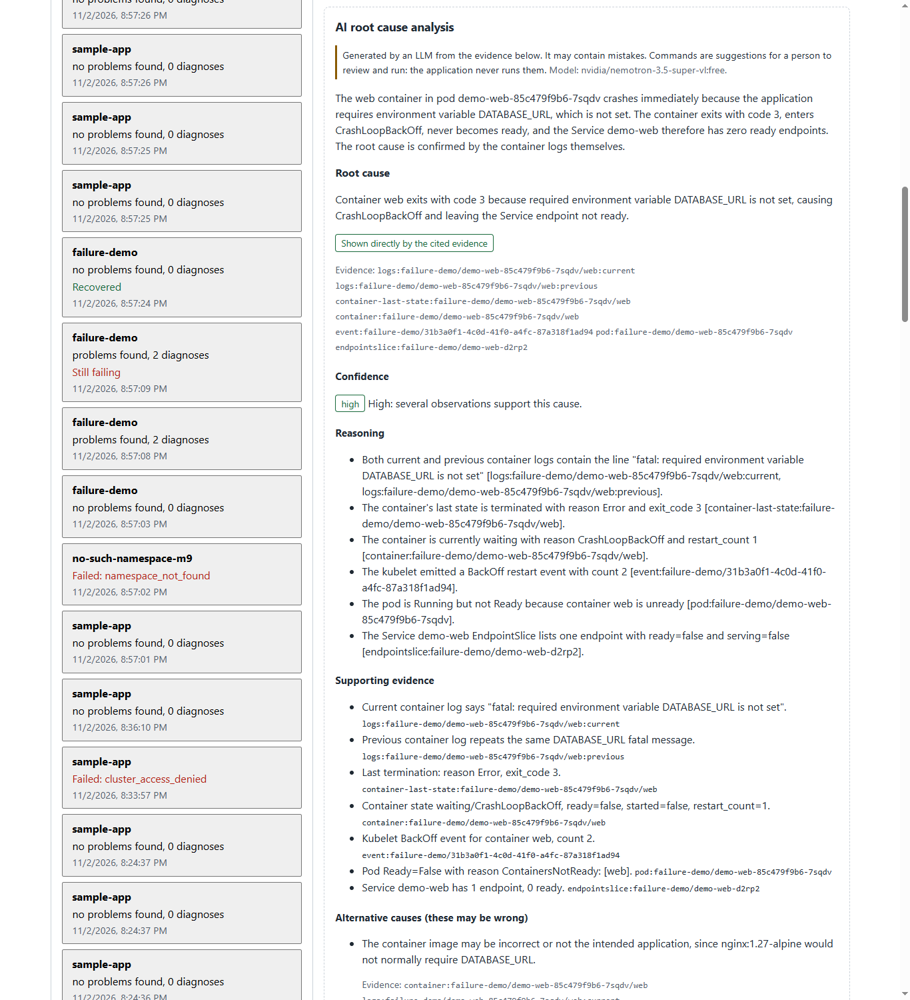
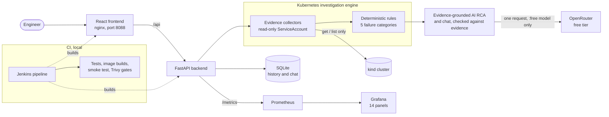
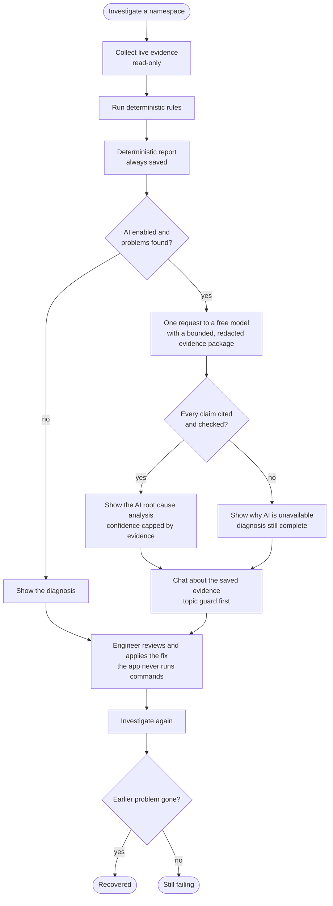
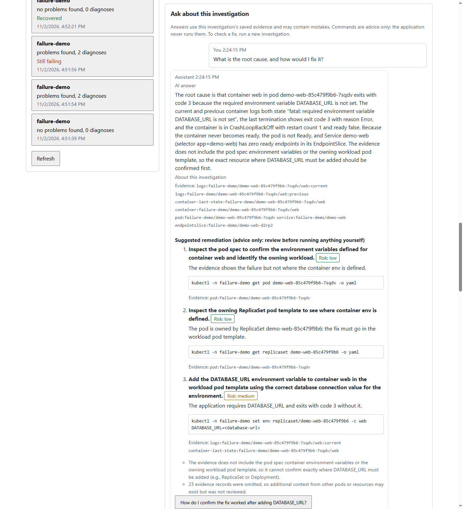
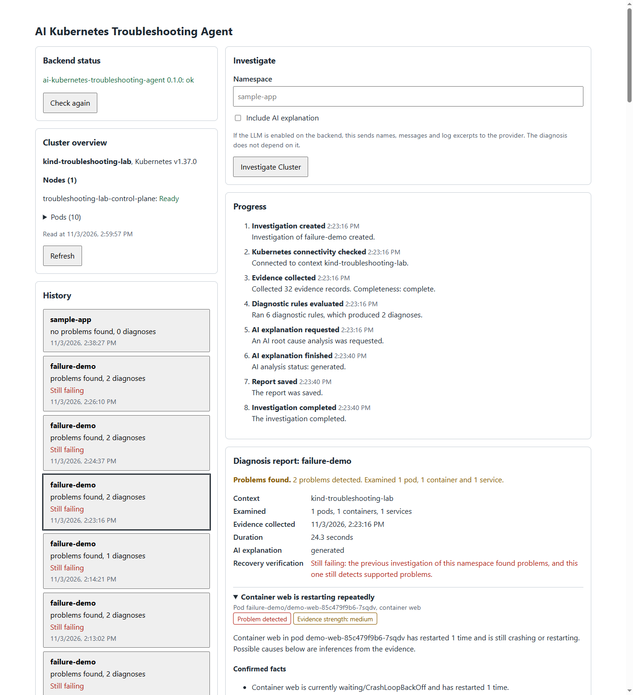
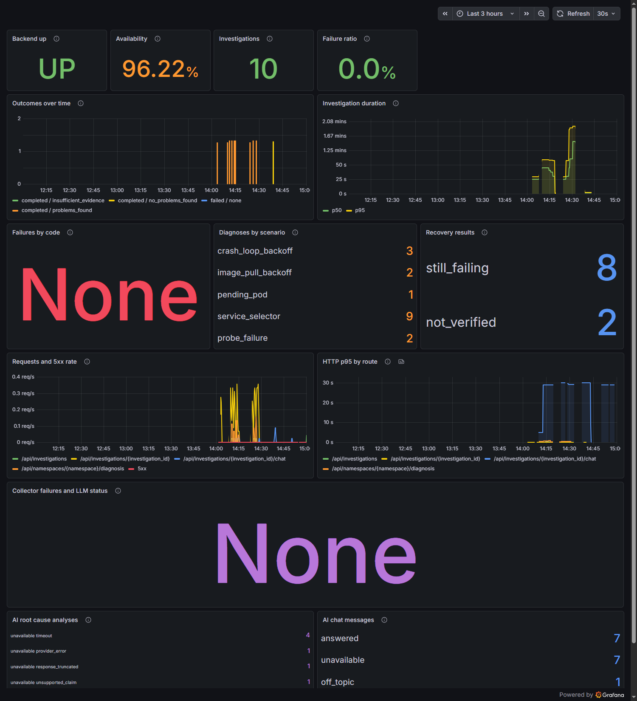

# AI Kubernetes Troubleshooting Agent

Investigates real Kubernetes failures with read-only access, diagnoses them with deterministic rules, and adds an evidence-grounded AI root cause analysis using a free LLM. Every AI claim must cite the collected evidence, and the application never changes the cluster.



## What it does

- **Investigates a namespace** in a real local kind cluster, with live progress, and saves the history so it survives restarts.
- **Diagnoses five failure categories** with deterministic rules: CrashLoopBackOff, ImagePullBackOff, Pending pods, Service selector mismatch, and readiness or liveness probe failures.
- **Adds an AI root cause analysis.** A free LLM reasons over the evidence, must cite it, and its confidence is limited to what the evidence supports. Answers that invent names, values or URLs are rejected.
- **Lets you chat about an investigation,** using its saved evidence. A topic guard refuses unrelated questions without calling the LLM.
- **Suggests fixes, but never applies them.** The backend's Kubernetes identity is read-only, so the cluster itself refuses any change.
- **Verifies recovery.** Investigating again after a manual fix shows whether earlier problems are gone. Reproducible failures in [k8s/scenarios](k8s/scenarios) demonstrate the full lifecycle.

The project works fully without an API key. Without the LLM, the deterministic diagnosis is complete on its own.

## Architecture



## How an investigation works



## Engineering highlights

| Area | What was built | Details |
|---|---|---|
| Least privilege | A dedicated ServiceAccount that can only get and list what the collectors use. Tests prove writes are refused | [M7](docs/M7_RBAC_SECURITY.md) |
| Evidence grounding | Every AI claim must cite evidence that was sent. Invented names, IDs, timestamps, values and URLs are rejected. Logs are treated as untrusted data | [M10](docs/M10_AI_AGENT.md#root-cause-analysis) |
| Cost control | Free models only, enforced in four places, a local request budget, and a key with no credit | [M10](docs/M10_AI_AGENT.md#free-models-only) |
| Real-model validation | 23 real requests to a free model, with the failures found and fixed, recorded honestly | [M10](docs/M10_AI_AGENT.md#real-model-validation) |
| CI/CD and security gates | A Jenkins pipeline runs tests, lint, builds, manifest and monitoring validation, a smoke test, and Trivy vulnerability and secret gates | [M8](docs/M8_DOCKER_JENKINS_TRIVY.md), [M10](docs/M10_AI_AGENT.md#jenkins) |
| Observability | Prometheus metrics with bounded labels, a provisioned Grafana dashboard, and three alert rules shown in Prometheus. Nothing sends notifications | [M9](docs/M9_MONITORING.md), [M10](docs/M10_AI_AGENT.md#monitoring) |
| Reproducible failures | Five failure scenarios on a real cluster, each with a fix and recovery verification | [M6](docs/M6_FAILURE_SCENARIOS.md) |

## Screenshots

All screenshots come from the running application on a local kind cluster.

**Chat about an investigation,** citing evidence, with commands shown as advice only:



**The dashboard during an investigation:** cluster overview, history, live progress and the deterministic diagnosis:



**Grafana after the real-model validation,** including the AI analysis and chat panels:



## Tech stack

| Layer | Technology |
|---|---|
| Frontend | React, Vite, served by unprivileged nginx |
| Backend | Python 3.13, FastAPI, Pydantic |
| Kubernetes | Official Kubernetes Python client, kind, read-only RBAC |
| AI | OpenRouter free tier, `nvidia/nemotron-3.5-super-vl:free`, through a provider interface with no framework |
| Storage | SQLite |
| Containers | Docker, Docker Compose |
| CI/CD and security | Jenkins Declarative Pipeline, Trivy, kubeconform |
| Observability | Prometheus, Grafana |
| Tests | pytest, Ruff, Vitest, React Testing Library, oxlint |

## Testing and CI

| Check | Result |
|---|---|
| Backend tests that need no cluster | 1,267 passed |
| Frontend tests | 41 passed |
| Real-cluster tests, with the restricted identity | 128. A few live cases depend on timing and occasionally need a rerun, as recorded in [M10](docs/M10_AI_AGENT.md) |
| Jenkins build #30 | Passed every stage: tests, lint, builds, manifests, monitoring rules, smoke test, and Trivy gates for both images and the source |

Jenkins runs locally, in its own Docker daemon, and nothing is published. It has no API key and never calls the LLM: tests use a local stand-in for the provider.

## Current status

| Milestone | Status |
|---|---|
| M0: Environment and foundation | Done |
| [M1: Local Kubernetes connectivity](docs/M1_LOCAL_KUBERNETES.md) | Done |
| [M2: Evidence collection](docs/M2_EVIDENCE_COLLECTION.md) | Done |
| [M3: Deterministic diagnostics](docs/M3_DIAGNOSTICS.md) | Done |
| [M4: Optional LLM integration](docs/M4_LLM_INTEGRATION.md) | Accepted with documented limitations. The real provider was first used in M10 |
| [M5: React dashboard](docs/M5_REACT_DASHBOARD.md) | Done |
| [M6: Failure scenarios and recovery verification](docs/M6_FAILURE_SCENARIOS.md) | Done |
| [M7: Kubernetes RBAC and security](docs/M7_RBAC_SECURITY.md) | Done |
| [M8: Docker, Jenkins CI/CD and Trivy](docs/M8_DOCKER_JENKINS_TRIVY.md) | M8 completed |
| [M9: Prometheus and Grafana monitoring](docs/M9_MONITORING.md) | M9 completed |
| [M10: AI troubleshooting agent](docs/M10_AI_AGENT.md) | M10 completed, validated with 23 real requests to a free model. Jenkins build #30 passed every stage, including the Trivy gates; see [Jenkins](docs/M10_AI_AGENT.md#jenkins) |

The full requirements are in [docs/MASTER_PROJECT_REQUIREMENTS.md](docs/MASTER_PROJECT_REQUIREMENTS.md).

## Security and limitations

- **The cluster cannot be changed by this application.** Its identity is read-only, and remediation is shown as advice for a person to review and run.
- **The API key stays on the server.** In Docker it is a secret file, not an environment variable, and it is never logged or returned.
- **Cluster data is untrusted.** Logs and events reach the LLM only as quoted data, and answers are checked before they are shown.
- **The checks are heuristic.** They catch invented values and forbidden claims, but cannot prove that advice is the best fix. A real answer once suggested editing a ReplicaSet instead of its Deployment.
- **Free models vary.** They can be slow or unavailable, and some real answers failed the checks. The deterministic diagnosis is always there.
- **Free models may log prompts.** Evidence is redacted, but names and log excerpts leave the machine. Use it with lab clusters, not production.
- **The API has no login.** It is for local use only.
- **The backend image has known operating-system vulnerabilities with no fix available yet.** The Trivy gate blocks any that become fixable.

More detail: [M7 security limitations](docs/M7_RBAC_SECURITY.md#security-limitations), [M9 remaining security findings](docs/M9_MONITORING.md#remaining-security-findings), [M10 security and limitations](docs/M10_AI_AGENT.md#security).

## Prerequisites

- Python 3.13
- Node.js 22.12 or newer
- Git
- Docker Desktop with cgroup v2, and kind 0.33.0 (only for the cluster features)

Environment findings for this project's development machine are in [docs/ENVIRONMENT.md](docs/ENVIRONMENT.md).

## Set up the cluster

Follow [docs/M1_LOCAL_KUBERNETES.md](docs/M1_LOCAL_KUBERNETES.md#set-up-the-cluster). The backend and frontend still start without a cluster; the cluster endpoint then returns HTTP 503.

## Run the backend

From the repository root, in PowerShell:

```powershell
cd backend
python -m venv .venv
.\.venv\Scripts\python.exe -m pip install -r requirements-dev.txt
$env:KUBECONFIG = "$env:USERPROFILE\.kube\troubleshooting-agent.kubeconfig"
.\.venv\Scripts\python.exe -m uvicorn app.main:app --reload --port 8000
```

`KUBECONFIG` must point at the restricted kubeconfig. Create it once, and renew it every 8 hours, by following [docs/M7_RBAC_SECURITY.md](docs/M7_RBAC_SECURITY.md#set-up). Without it, the backend still starts, but its cluster features explain what is missing. It never falls back to administrator credentials unless you [explicitly allow that](docs/M7_RBAC_SECURITY.md#local-development-without-the-restricted-identity).

| URL | Purpose |
|---|---|
| <http://127.0.0.1:8000/api/health> | Backend health |
| <http://127.0.0.1:8000/api/cluster/health> | Live nodes and pods from the current kubeconfig context |
| <http://127.0.0.1:8000/api/namespaces/sample-app/evidence> | Live evidence for one namespace |
| <http://127.0.0.1:8000/api/namespaces/sample-app/diagnosis> | Deterministic diagnosis of one namespace |
| <http://127.0.0.1:8000/api/namespaces/sample-app/diagnosis?explain=true> | The same, with an optional LLM explanation |
| <http://127.0.0.1:8000/api/investigations> | Saved investigations |
| `GET`/`POST` `/api/investigations/{id}/chat` | Chat about one saved investigation |
| <http://127.0.0.1:8000/docs> | Interactive API docs |

Saved investigations and chats are kept in `backend/data/investigations.db`, which Git ignores.

No API key is needed. To turn on the AI analysis and chat with a free model, follow [docs/M10_AI_AGENT.md](docs/M10_AI_AGENT.md#set-up).

## Run the frontend

In a second PowerShell window, from the repository root:

```powershell
cd frontend
npm ci
npm run dev
```

Open <http://localhost:5173>, enter a namespace such as `sample-app`, and click **Investigate Cluster**. The page shows real results from the backend, or an error if the backend or cluster is not available. See [docs/M5_REACT_DASHBOARD.md](docs/M5_REACT_DASHBOARD.md).

## Run it in Docker

To run the application in containers, at <http://localhost:8088>, or the Jenkins pipeline, at <http://localhost:8090>, follow [docs/M8_DOCKER_JENKINS_TRIVY.md](docs/M8_DOCKER_JENKINS_TRIVY.md). To add Prometheus and Grafana, at <http://localhost:3001>, follow [docs/M9_MONITORING.md](docs/M9_MONITORING.md). To add the AI, with the key as a secret file, follow [docs/M10_AI_AGENT.md](docs/M10_AI_AGENT.md#set-up).

Do not run the application and the Jenkins stack at the same time on a machine with limited memory.

## Interview demonstration

A walkthrough of about 8 minutes, talking points, and a troubleshooting guide are in [docs/M10_AI_AGENT.md](docs/M10_AI_AGENT.md#interview-walkthrough-about-8-minutes).

## Run the checks

```powershell
# From backend/: lint, and tests that need no cluster
.\.venv\Scripts\ruff.exe check app tests ..\scripts
.\.venv\Scripts\python.exe -m pytest

# From backend/: tests against the real kind cluster, with the backend restricted
$env:TEST_ADMIN_KUBECONFIG = "$env:USERPROFILE\.kube\config"
$env:KUBECONFIG = "$env:USERPROFILE\.kube\troubleshooting-agent.kubeconfig"
.\.venv\Scripts\python.exe -m pytest -m cluster

# From frontend/
npm run lint
npm test
npm run build
```
